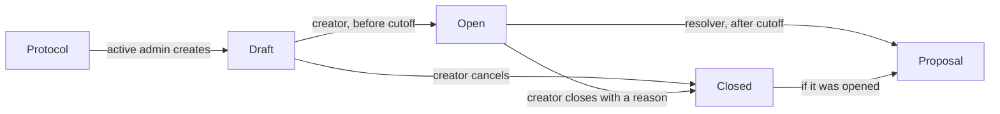

# Architecture

Daml 3 (SDK 3.7.1, LF 2.1). Production code depends only on `daml-prim`,
`daml-stdlib` and the pinned Token Standard interfaces; tests live in a separate
package. Packages:

| Package | Contents |
| --- | --- |
| `contracts/roles` | Read-only `ProtocolRoles` interface, kept apart for upgrade safety |
| `contracts/factory` | Interface-only market factory standard (see [clubs](clubs.md)) |
| `contracts/main` | Protocol, custody, positions, orders, resolution, clubs, multi-outcome, profiles |
| `contracts/test` | Daml Script tests, a test token registry and fault injection |

## Roles and trust

- **Operator** signs `Protocol`, which holds the admin list (at most 64), the
  market counter and the taker-fee policy. Only the operator changes admins or fees.
- **Admins** create markets with `Protocol_CreateBinary`; the creator must stay an
  active admin to open, close or resolve it.
- **Vault** is a separate party that holds all collateral. It co-signs balances,
  reserves, orders and books with the operator.

The operator and vault together are trusted: they could jointly create other
contracts outside these choices, and the vault's signing authority could move its
holdings directly. This is not a trustless Solana PDA. Clients must pin the
intended operator, protocol name and roots (`VaultAuthority`, `PositionRegistry`,
`OrderRegistry`). IDs are unique within that lineage, not globally.

Every consuming choice replaces a contract ID. Use stable identities, never
contract IDs:
- **Markets:** `MarketKey { operator, protocolName, marketId, scope }`.
- **Balances:** `(party, instrument)`.

Clients must refresh IDs from each result.

## Market lifecycle



- **Fixed terms:** each market fixes, at creation:
  - the question (500 characters);
  - YES/NO/invalid criteria and evidence requirements (4,096 characters each);
  - a rules URI (`ar://` or `https://`) and its SHA-256;
  - the collateral instrument;
  - the trading cutoff, an optional earliest resolution time and an optional fallback resolver;
  - a review delay (1 second to 7 days), the price tick and the whole-contract lot.

  The structured fields are authoritative; the contracts check the URI and digest
  shape, not the document.
- **Time:** comparisons use ledger time, and status never changes on its own.
  Trading choices check `Open` and `now < closeAt`. Closing early stops trading but
  does not move the resolution schedule.
- **Contention:** creation consumes the single `Protocol`, so it is serialized.
  Opening and closing only fetch it.

## Collateral

**Admission.** The operator approves each asset with `Protocol_ApproveAsset`, which
pins:
- the instrument;
- the exact registry transfer factory, which the operator must authenticate first
  (a factory view naming an admin proves nothing);
- the settlement precision `d` (0–10).

**Transfers** go through Token Standard V2:
- **Limits:** 1–16 unlocked basic-account inputs, a positive amount, and a deadline
  at most 5 minutes ahead.
- **Results:** only `Completed` is accepted. The receiver must get exactly the amount
  and the sender exactly the change; for example, inputs of 5 and a transfer of 3
  must give 3 received and 2 change.
- **Failures:** any other output shape, a pending or failed result, or extra fees
  roll back the whole transaction.

**Custody.**
- **Balances:** a trader enrolls once per asset in `VaultAuthority` (at most 1,024
  enrollments). `AssetBalance`, signed by the trader and the vault, is backed by one
  vault-owned holding.
- **Deposits** consolidate wallet tokens into that holding in the same transaction:
  2 available plus a deposit of 3 gives one holding of 5.
- **Withdrawals** are owner-only and use the saved factory even after admission is
  revoked. Revocation blocks new funding, never exits.
- **Unsupported registries:** ones that fragment outputs. Issuer freezes and factory
  retirement still need an exit policy.

## Complete sets

`PositionRegistry` creates one `MarketReserve` per market (at most 1,024).

- **Split:** owner only, while the market is Open and before cutoff. It moves `Q`
  collateral from the trader's balance into the reserve and creates a `PositionLot`
  of `Q` YES and `Q` NO.
- **Merge:** burns `Q` of each, from 1–16 lots, and credits `Q` back. It needs no
  open market or admin, so it works after closure or cutoff, until the resolution
  is bound to the reserve.

```text
outstanding YES = outstanding NO = completeSets
reserve holding = completeSets × 1 collateral unit
vault cash = available balances + reserves + buy escrows + fee pools
```

Every split or merge consumes the market's reserve and the trader's balance, so
requests on one market serialize and stale IDs fail. Lots are Daml contracts, not
Token Standard tokens in the wallet.

## Visibility

Canton is not a globally readable account store. The operator and vault host every
contract. Traders see their own balances, lots and orders; club members see their
club (see [clubs](clubs.md)). Public discovery needs an operator service that
discloses approved market data. Matched traders see the nested settlement,
including the fetched book. Known exposure: `VaultAuthority` lists every enrolled
`(party, instrument)` and is disclosed to each enrolling party.
