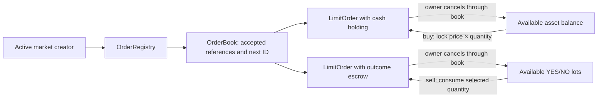

# Binary limit orders

This checkpoint adds fully funded resting buys/sells and owner cancellation.
It does not execute trades. Crossed orders may coexist until matching is added;
the shared UI must keep Canton trading disabled.



## Funding

A buy for 3 YES at 0.40 locks exactly 1.20 collateral in a separate vault holding.
The available balance falls by 1.20. Both old backing and account revisions are
consumed in that transaction. An empty account has no holding; it can still
receive a cancellation refund. Fees are not implemented in this checkpoint.

A sell for 3 YES consumes the supplied position lots and records 3 YES inside
the signed order. Remaining YES and all NO return in one available lot. The
selected contracts cannot also be merged or sold again: their old lots no longer
exist. The market's complete-set reserve stays unchanged.

```text
actual vault cash = available balances + complete-set reserves + buy escrows
outstanding YES = available YES lots + YES sell escrows
outstanding NO  = available NO lots  + NO sell escrows
```

Before resolution, each outcome's total equals the complete-set count. Cancelling
a sell changes where the contracts are recorded, not the total supply.

Buyers and sellers need no admin role. New orders require a current Open market
strictly before cutoff. The book checks stable market identity, creator, original
creation time and every immutable term. Prices must be strictly between zero
and one collateral unit and follow the price tick. Quantities must be positive
whole-contract multiples of the lot size. A sell accepts 1–16 unique position
lots from the same owner, vault and market.

Tick checks use exact scaled integers. Decimal has ten fractional digits; prices
below one scale to fewer than 10^10 integer units. Integer remainder avoids
division rounding accepting a price just off tick, such as 0.4000000001 on a
0.01 tick. `price × quantity` then determines the exact collateral escrow.

## Initialization and identity

`OrderRegistry` is signed by the operator and vault. The market creator must
still be an active admin to initialize its book. The supplied reserve and market
must agree on vault, namespace, ID, creator and immutable terms. Initialization
is allowed before cutoff in Draft or Open state; placement requires Open.

The configured registry lineage creates one book per market ID. Its index is
limited to 1,024 IDs. Deployments must pin this root alongside the account and
position roots. Joint operator/vault signers could create another root; there
is no global uniqueness guarantee against them.

`OrderBook` commits at most 128 active references across YES/NO and both sides.
Each accepted order gets a monotonically increasing ID. Cancellation removes a
reference but does not reset that counter. IDs are unique within this configured
book lineage, not across all markets or deployments. Sequence exhaustion blocks
new placement without blocking cancellation.

## Cancellation

Only the owner cancels through the current book revision and exact order ID.
The book verifies its committed reference, owner, asset, factory, vault and market.
It removes the reference and archives the order in the same transaction as the
refund. A buy requires the owner's current matching asset balance. A sell takes
no cash account and recreates only the escrowed outcome quantity.

Cancellation does not fetch a market, protocol or admission. Closure, cutoff,
admin revocation and admission revocation cannot themselves block it. Registry
freezes or outages can still prevent a buy refund. Sell cancellation needs no
token-registry transfer.

`LimitOrder_Release` is an internal choice requiring both owner and vault
authority. A trader cannot call it alone and leave a stale reference in the book.
The book delegates the vault authority only after its checks. Raw vault signing
authority remains trusted and can bypass application accounting, as described in
[custody](collateral-custody.md). There is no untrusted-signer guarantee here.

Stale book/account/lot IDs, duplicate inputs, missing outcomes, incorrect backing
or faulty registry output reject the whole transaction. If a refund fails after
registry consumption, the order, index entry, balance and escrow all remain live.

## Price-time priority and matching

`bestOrderReference` selects within one outcome and side: highest buy or lowest
sell price first, then lowest accepted ID. Ledger timestamps are informational;
two orders at the same timestamp have a definite order through the counter.

This is a bounded reference index, not a linked price-level tree. Selection sorts
at most 128 references. Placement and cancellation consume one market book, so
concurrent requests on that market serialize and stale clients retry. Different
markets have separate books, while the same trader account remains a shared
spending dependency. The bounds simplify the first implementation but limit
throughput and depth; measure both before choosing a larger structure.

The [pure matching planner](binary-matching.md) now defines maker-price execution,
partial-fill amounts and cancel-newer self-trade behavior. It executes nothing.
Settlement must fetch the current book and validate its best reference in the
settlement transaction. An off-chain matcher supplying a candidate is not proof
of FIFO. Partial fills must update the order and its reference together, preserve
the original acceptance ID, transfer outcome ownership, settle cash and return
price improvement. Fees, bounded fill batches and cross-outcome matching remain separate work.
The selected same-outcome plan still needs atomic escrow updates and tests.

## Verification and deployment limits

The tests reconcile actual holdings and available/escrowed positions. They cover
both outcomes, full-balance buys, partial lot use, multiple lots, ownership,
cross-market isolation, exact cutoff, closure/revocation cancellation, replay,
price-time selection and registry rollback. Capacity tests use genuinely funded
orders and lots, including reuse of a cancelled slot with a new sequence ID.

The test package configures a 32 MiB script-service message limit because the
128-order test returns its full IDE-ledger history with successive book snapshots.
This is a test transport setting, not permission to exceed a deployed ledger's
transaction limits. Public-network size/latency measurements, contract disclosure,
Console Wallet submission and registry compatibility remain unverified.

Run `make DPM="$PWD/target/tools/dpm" test`. Only the production DAR is deployable;
the test DAR includes the test registry and `daml-script`.

Verified in this checkpoint: 67 Daml scripts (19 order scripts), four Python
dependency tests and production DAR validation with 38 packages.
