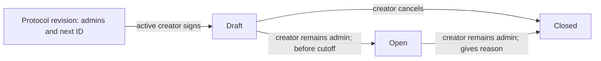

# Binary market lifecycle

This checkpoint added Daml contracts for draft creation, opening and administrative
closure. [Transfers](collateral-transfers.md), [balances](collateral-custody.md)
and [complete sets](complete-set-positions.md) are separate contract modules.
Orders, matching, resolution and payouts remain unimplemented. The
shared frontend must keep showing `Market deployment pending` until a deployment
and wallet-to-ledger integration are verified.



## Contracts and permissions

`Protocol` is signed by the operator and observed by its admins. Only the operator
can replace the admin list. The operator must remain an admin. Lists are limited
to 64 unique parties.

An active admin exercises `Protocol_CreateBinary` as the creator. The transaction
consumes the old protocol revision, advances its market counter and creates a
draft. Invalid terms roll back the whole transaction, including the counter.
Clients must use the returned protocol ID for the next creation or admin update.

`BinaryMarket` is signed by both operator and creator. The factory delegates the
operator's authorization; the creator supplies their own. A creator cannot
independently fabricate a market or bypass transitions through `Archive`.
The operator and creator together are trusted signatories. The package does not
prevent them from jointly creating alternative state. The operator can also
bootstrap another protocol root; services must pin their intended operator/name
and track one configured lineage. IDs are unique within that lineage, not globally.

Opening and administrative closure require the creator's signature and a fetch
of a live matching protocol revision that still lists them as an admin. Another
admin cannot manage their market. Revoking admin status blocks these actions on
existing drafts and open markets. A removed creator may still cancel an unused
draft. No cancellation or closure here grants access to anyone's funds.

## Fixed terms

Each market records its question, collateral instrument's admin/ID, YES/NO/invalid
criteria, evidence requirements, rules URI/hash, trading cutoff, optional earliest
resolution time, optional fallback, resolution delay, price tick and quantity lot.
All remain unchanged across lifecycle transitions. The creator is the planned
primary resolver. The fallback is recorded now; neither resolver can submit an
outcome in this checkpoint.

Questions are limited to 500 characters; each criteria/evidence field to 4096.
A rules URI uses `ar://` or `https://` and a lowercase SHA-256 hex digest. Contracts
check URI/digest shape, not remote availability or whether the external document
matches the structured criteria. The structured fields are authoritative. The
future frontend must verify document bytes and their consistency before approval.

No earliest-resolution value means the trading cutoff is the earliest eligible
time. No fallback means there is no fallback resolver. A configured fallback may
omit its final deadline. A supplied deadline is exclusive and must follow its
availability time; availability cannot precede the earliest resolution time.

Resolution delay is 1–604800 seconds. Price tick is greater than zero and below
one collateral unit. Quantity lots are positive whole contracts. These are terms,
not a claim that an identified instrument's transfer API is integrated yet.

## Time and closure

Creation and opening require ledger time strictly before `closeAt`. At exactly
the cutoff, opening fails. Canton ledger time has bounded skew; it is not a precise
wall-clock timestamp. Test cases at exact boundaries use the static IDE ledger.

The status does not change automatically when time passes. Future trade choices
must check both `Open` and `now < closeAt`. Manual closure is terminal and may occur
after the cutoff. Closing early stops trading but does not move the resolution
schedule or decide a winner. Resolution, invalid-market handling and redemption
need separate contracts and tests before public funding is enabled.

## Visibility and contention

Canton is not a globally readable Solana account store. The operator/creator see
market contracts; admin membership exposes protocol configuration. A future
public-discovery service must publish approved market information. Arbitrary
wallets cannot query every contract merely because it is a public product market.
Private clubs and their disclosure/membership rules remain separate work.

A single consumed protocol revision simplifies sequential ID allocation and
admin updates, but serializes creation. Independent markets do not share that
write lock when opening or closing: they only fetch the current protocol.
Market status changes consume and replace their own contract; clients must refresh
its ID. Later trading must use stable market identity rather than a lifecycle ID.

## Build and checks

The packages pin DPM SDK 3.7.1 and target Daml-LF 2.1. Production code depends only
on `daml-prim`, `daml-stdlib` and pinned Token Standard interface DARs. The separate test package imports the compiled
production DAR and adds `daml-script`.

```bash
make build
make test
```

DPM's local-path bug affects this checkout's spaces. See [the reproduction and
candidate fix](dpm-local-path-issue.md). The local validation command is:

```bash
make DPM="$PWD/target/tools/dpm" test
```

The ten scripts cover authorization, active-admin revocation/regrant, wrong
protocols, cutoff boundaries, immutable terms, stale contract IDs, draft
cancellation, admin-list rules, optional schedules, counter exhaustion and 26
malformed-input attempts with rollback. These run on the IDE ledger. They do not
establish multi-participant behavior, wallet signing or public-network deployment.
