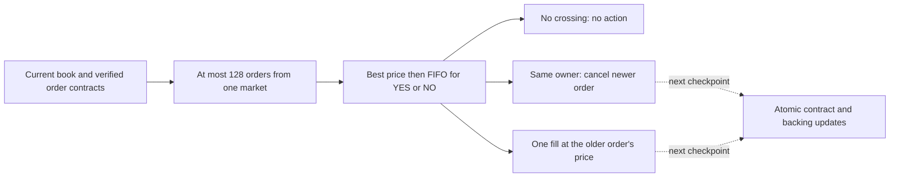

# Binary matching

The first matching checkpoint is a pure planner. It selects one pair and
calculates the amounts. It does not execute, cancel or settle orders.

## Selection

Match YES buys with YES sells, and NO buys with NO sells. Buy priority is highest
price, then lowest acceptance ID. Sell priority is lowest price, then lowest ID.
The order index and planner share the same priority helper; input list order and
ledger timestamps do not break ties.

A pair crosses when the buy limit is at least the sell limit. The earlier
accepted order is the maker and supplies the execution price. This covers the
current model, which can contain crossed resting orders because execution has
not been implemented. It is not an immediate-or-cancel or market-order API.

If the best pair has the same owner, return a request to cancel its newer order.
Do not skip that pair to execute a lower-priority order. The next checkpoint must
actually release that order's backing and remove its book reference atomically;
until then this result is only a plan. Cancellation preserves the older order's
priority and prevents a self-cross from becoming a trade or fee-generating fill.

## Amounts

Fill the smaller remaining quantity. Both quantities must follow the market lot,
so their minimum and remainders also follow it. Fees are zero in this checkpoint.

For a buy of 5 at 0.60 against an older sell of 3 at 0.40:

| Result | Amount |
| --- | ---: |
| Contracts delivered to buyer | 3 |
| Collateral credited to seller | 1.20 |
| Price improvement returned to buyer | 0.60 |
| Remaining buy contracts | 2 |
| Collateral still backing that buy | 1.20 |

The original 3.00 buy escrow equals seller proceeds + buyer refund + remaining
buy escrow. The remaining buy stays funded at its original limit. If the buy is
the older order, execution is at its buy price and its improvement refund is zero.
An unfilled sell keeps its remaining contracts in escrow with its original ID.

Prices are Daml Decimal values with ten fractional digits. Quantity is a positive
Int. Tick checks scale sub-unit prices to exact integers; no floating-point or
rounded division is used. Price times integer quantity is exact within these
bounds. No planner step changes complete-set reserves or total outcome supply.

## Validation and limits

Reject invalid tick/lot values, more than 128 entries, repeated or nonpositive
acceptance IDs, invalid/off-tick prices, and nonpositive/off-lot quantities.
Validate the whole snapshot, including the outcome not currently selected.
An empty or one-sided book returns no match.

This is a bounded sorted-list design. One plan fills one pair; a later service
can request another after settlement returns the successor book. It does not
promise a multi-fill transaction or high-throughput price-level indexing.

## Settlement boundary

The snapshot is not proof of ownership, funding or contract liveness. Before
using a plan, a ledger choice must:

1. Fetch the current Open market before cutoff and its committed book lineage.
2. Fetch the indexed orders and verify their IDs, terms, owners, factory, asset,
   market, vault, and exact escrow backing.
3. Recompute priority and amounts inside that transaction; never accept a
   caller-supplied plan as authority.
4. Consume both order revisions and distribute actual backing and outcome rights.
5. Recreate partial orders with the original acceptance IDs and replace their
   references in the book in the same transaction.
6. Record the fill and return successor account/book/position IDs. Any failure
   must leave the previous orders, balances and backing unchanged.

Authorization needs particular care: the existing internal balance choice needs
owner and vault authority. A plan grants neither. The implementation must compose
signed order choices without requiring both traders to approve every later fill
and without granting an arbitrary caller authority to move their other funds.
The vault and admitted registry remain the custody trust boundaries.

## Checks

The planner tests cover both outcomes, maker direction, equal-price fills,
price/FIFO selection, partial fills, self-trades, snapshot rejection, capacity,
the smallest tick and largest Int quantity. A 324-case grid checks price limits,
remaining quantities and exact cash conservation, including noncrossing cases.
Existing funded-order tests exercise the shared priority and tick helpers.
These checks do not establish live settlement or registry compatibility.

Verified locally: 76 Daml scripts, four Python dependency checks, and production
DAR validation with 38 packages. Only the production DAR is deployable; the test
DAR contains `daml-script` and the test registry.
