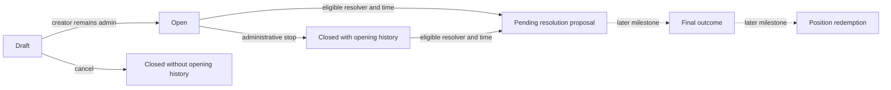

# Binary resolution proposals

This checkpoint creates pending outcome proposals. It does not finalize a winner,
pay rewards, burn positions or move reserve collateral. Public Canton trading
remains gated until deployment and wallet submission are verified.

## Who can propose

The market creator is the primary resolver and must still be an active protocol
admin. The operator or another admin cannot propose in the creator's place.

A fallback must be explicitly nominated in the immutable market terms and must
also be an active admin when proposing. Nomination alone does not grant admin
status. The operator must enroll that party; revocation blocks its proposal
choice. No nomination means no fallback, including no implicit operator fallback.
The configured fallback observes the market/proposal so it can access its role
without impersonating another party. Visibility does not itself authorize a call.

Both choices fetch a current matching protocol revision. Wrong operator/name,
stale IDs, revoked membership and missing resolver signatures reject atomically.
As elsewhere, services pin the intended protocol lineage. Joint operator/creator
signers remain trusted and could create alternative state outside these choices.

## Opening history and timing

`BinaryMarket.openedAt` records successful opening. It is absent on drafts and
cancelled drafts and survives administrative closure. A never-opened market
cannot propose an outcome, regardless of its closure-reason text.

```text
earliest proposal = earliestResolutionAt, if supplied; otherwise closeAt
primary window    = [earliest proposal, fallback.availableAt)
fallback window   = [fallback.availableAt, fallback.deadlineAt)
```

Without a fallback, the primary has no end time. Without a fallback deadline,
the fallback has no expiry. Exact availability belongs to fallback; the deadline
is exclusive. An administrative early close does not accelerate these times.
Comparisons use ledger effective time, not an exact wall-clock guarantee.

A deadline can leave a market unresolved if nobody submits in time. This
checkpoint does not silently extend the deadline, select a winner or void it.
The configured fallback is only used if no proposal has already consumed the
market. Proposal correction/replacement and finalization are later work; the
fallback cannot yet override an existing primary proposal.

## Proposal contents

A proposal records:

- Stable market key, creator, immutable terms, creation time and opening time.
- Proposing resolver and `YesWins`, `NoWins` or `Invalid`.
- Evidence summary, URI and SHA-256 digest.
- Proposal time and `finalizableAt = proposedAt + resolutionDelaySeconds`.

The summary must contain 1–4096 characters. The URI uses `https://` or `ar://`
and has at most 512 characters. The digest must be 64 lowercase hexadecimal
characters. These are format checks: the contract cannot fetch the document or
verify that its contents prove the result. Clients must verify document bytes
and their consistency with the pre-agreed criteria.

`Invalid` is distinct from NO. Its payout formula is not implemented by this
checkpoint. A pending proposal grants no redemption right, including after its
`finalizableAt` timestamp; there is no finalization choice yet.

## One proposal and preserved exits



A successful proposal consumes the active market revision and creates one signed
`ResolutionProposal`. Reusing the old market ID fails, so two proposal choices
cannot succeed through that same revision. An invalid proposal rolls back market
consumption. No separate independently created registry is introduced here.

Consuming the market prevents further market-dependent commands. Owner order
cancellation still requires neither market nor protocol, so it remains available
and refunds all unearned fee budget. Existing complete-set merge and wallet
withdrawal paths are unchanged. Finalization will need an explicit reserve/merge
transition before any redemption can be considered safe.

## Verification and remaining work

The full suite passes 156 Daml scripts, including 13 proposal scripts, plus four
Python dependency checks and the independent fee arithmetic checks. Production
DAR validation passes with 38 packages.

The tests cover exact cutoff/earliest/handover/deadline boundaries, absent optional
times, primary/fallback authorization and revocation, cancelled drafts, evidence
rollback, duplicate proposals, forged snapshots and funded owner cancellation.
The IDE ledger uses static time for exact boundary cases.

Next: proposal corrections and delayed finalization, followed by collateral-backed
YES/NO/invalid redemption and asset-conservation tests. The shared UI must expose
these as working actions only after their contracts and wallet flow are verified.
