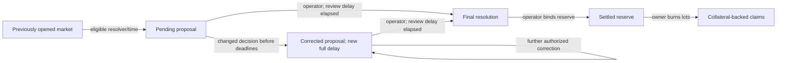

# Binary resolution

Markets support outcome proposals, corrections and delayed finalization. These
transitions move no reserve collateral, trader cash, positions or fee holdings.
Redemption is not implemented. Public Canton trading remains gated until
contracts, registry compatibility and wallet submission are verified.

## Who decides the outcome

The market creator is the primary resolver and must be an active protocol admin
to propose or correct. The operator or another admin cannot choose a result in
the creator's place.

A fallback must be explicitly nominated in the immutable terms and must also be
an active admin when acting. Nomination does not grant admin status. No nomination
means no fallback, including no implicit operator fallback. The configured
fallback observes market/proposal/final contracts so it can access its role;
visibility alone grants no permission.

Proposal choices use the current protocol revision. Corrections use its
read-only `ProtocolRoles` interface, verifying the actual operator signature,
namespace and membership. A view claiming an operator or admin list is not
proof of authorization. Stale IDs and unsigned/foreign views reject atomically.

The interface lives in `contracts/roles`, separate from template implementations
in `contracts/main`. This avoids a protocol/resolution module cycle and preserves
the compiler's upgrade-safety check. Clients convert the current Protocol ID
with `toInterfaceContractId @ProtocolRoles`; they must not cache an old revision.
The interface package should keep its view stable across implementation upgrades.

## Opening history and resolver windows

`BinaryMarket.openedAt` records successful opening. It is absent on drafts and
cancelled drafts and survives administrative closure. A never-opened market
cannot propose, regardless of its closure-reason text. An early administrative
close stops trading but does not accelerate the resolution schedule.

```text
earliest proposal = earliestResolutionAt, if supplied; otherwise closeAt
primary window    = [earliest proposal, fallback.availableAt)
fallback window   = [fallback.availableAt, fallback.deadlineAt)
```

Without a fallback, the primary has no end time. Without a fallback deadline,
the fallback has no expiry. Exact availability belongs to fallback; its deadline
is exclusive. Resolver windows apply to proposals and corrections, not to
finalizing an existing timely proposal.

A missed deadline can leave a market unresolved. No choice silently extends it,
chooses a winner or voids it. Comparisons use ledger effective time, not a precise
wall-clock guarantee.

## Proposals and evidence

A proposal contains the market key, creator, immutable terms, creation/opening
times, resolver, outcome, evidence, proposal time, revision and finalization time.
`YesWins`, `NoWins` and `Invalid` are distinct. Invalid-result payout rules will
be specified and tested with redemption; a final record alone pays nothing.

Evidence requires a 1–4096-character summary, an `https://` or `ar://` URI of at
most 512 characters, and a 64-character lowercase SHA-256 digest. These checks
cannot establish truth or remote availability. Clients must verify document
bytes and their consistency with the pre-agreed criteria.

A successful proposal consumes the market revision and starts at revision zero:

```text
finalizableAt = proposedAt + resolutionDelaySeconds
```

Reusing the old market ID fails. Invalid evidence or another failed check rolls
back consumption, leaving the original market active.

## Corrections and review delay

`ResolutionProposal_Correct` requires all of the following:

- The caller is the current active admin who is eligible under the resolver window.
- Ledger time has not moved backward and is strictly before `finalizableAt`.
- The outcome or evidence actually changes, with valid evidence format.
- The revision counter has not reached Int64 maximum.

The choice consumes the old proposal, preserves market identity/terms/opening
history, increments revision and starts a full new review delay from ledger time.
Old correction and finalization IDs cannot replay. Failed and identical-payload
corrections do not reset the timer.

A configured fallback can replace a pending primary proposal after handover,
but only before the current review deadline and its own optional deadline.
A primary proposal may become finalizable before fallback availability; the
fallback is not guaranteed a later appeal period. Terms must reflect the intended
schedule. With no fixed expiry, a trusted resolver can repeatedly make substantive
corrections; no overall correction-count/time cap exists beyond revision bounds.

## Finalization

Only the operator can call `ResolutionProposal_Finalize`, at or after the current
`finalizableAt`. Exact equality is allowed; corrections are no longer allowed at
that boundary. The operator supplies no replacement outcome or evidence.

Finalization consumes the current proposal and creates `FinalResolution` with
its exact snapshot and finalization time. No choice changes its outcome or
reopens it. An elapsed fallback deadline or later resolver revocation does not
erase an earlier valid proposal or prevent operator finalization. Revocation
blocks new decisions; it is not an automatic dispute or veto over old decisions.



Owner cancellation and refunds remain available after proposal or finalization.
Complete-set merge remains available until the operator binds the final snapshot
and consumes the live reserve. [Redemption](binary-redemption.md) then credits
owned YES/NO/Invalid payouts to the trader's asset balance.

## Trust and verification

Services pin the intended protocol/market lineage. Joint operator/creator
signers remain trusted: they could directly create alternative state or jointly
archive records outside these choices. This is not a permissionless oracle or a
protection against those signers colluding. Operator finalization provides no
liveness guarantee if the operator stops submitting.

The full suite passes 178 Daml scripts, including 10 correction/finalization
scripts and 13 proposal scripts, plus four Python checks and the independent fee
arithmetic checks. The production DAR validates with 39 packages, including the
separate role-interface package.

The suite covers exact time boundaries, primary/fallback handover, revocation,
foreign/stale/forged role policies, correction rollback, replay, revision limits,
finalization permissions and preserved funded exits. A registry-backed test
compares all cash holding IDs/amounts before and after finalization: nothing moves.
Static IDE-ledger time is used for exact boundary cases.

Run `make DPM="$PWD/target/tools/dpm" test`. The production DAR excludes the test
registry and daml-script. The redemption suite also checks YES/NO/Invalid payouts through withdrawal.
Deployment and live wallet integration testing remain excluded from this feature.
