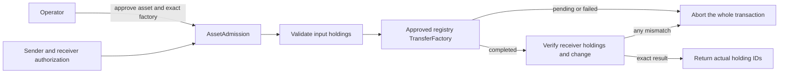

# Collateral transfer boundary

This is the first part of collateral support. It moves real ledger holdings
through the Token Standard V2 interface and verifies the result. It does not
create an Outcomia balance, lock backing collateral, mint YES/NO positions or
connect the shared UI to a live registry yet. [Custody balances](collateral-custody.md)
now use this boundary for deposits and withdrawals.



## Admission

Only the protocol operator can call `Protocol_ApproveAsset`. Admission binds the
operator, instrument admin/ID and exact transfer-factory contract. Its reported
admin must match the instrument. Only the operator can archive the admission.
The same admission can serve multiple markets using that asset.

The operator must authenticate the factory against the asset registry and review
its vetted implementation before approval. A factory view naming an admin is
not proof that it is that admin's genuine factory. An arbitrary registry's
honesty cannot be established from an interface view alone.

A caller supplies its expected operator and instrument when exercising
`AssetAdmission_Transfer`. Future market contracts must take those values from
their own signed terms. User-provided labels are not an authorization boundary.

## Transfer checks

Both sender and receiver authorize the operation. Self-transfers use one distinct
actor. Input and output accounts must be basic accounts: an owner, no provider
and an empty account ID. Other account models require a separate adapter.

The request must have a positive amount and 1–16 unique input holdings. Each
holding must be active, signed by the instrument admin, owned by the expected
account, denominated in that instrument, positive and unlocked. This deliberately
rejects locked holdings even when their lock might have expired. Instruments
using delegated signers rather than the configured admin are also unsupported.

The request timestamp cannot be in the future. The execution deadline is
exclusive and at most five minutes ahead of ledger time.

Only `Completed` is accepted. There must be 1–16 receiver holdings and at most
16 change holdings. IDs must be unique, disjoint and different from the inputs.
All returned holdings undergo the same signature/account/instrument/lock checks.
The receiver gets exactly the requested amount and the sender gets exactly the
input total minus that amount. For inputs totaling 5 and a transfer of 3, the
result must be 3 received and 2 change. Amounts use exact Decimal arithmetic.

Missing outputs, short payments, fees deducted from these amounts, extra change,
wrong assets/accounts, duplicate IDs, pending results and failed results abort
the entire transaction. This also rolls back a registry operation that has
already consumed the inputs. Separate network costs are outside this check.

## What this does not prove

A listed registry must obey the standard: consume the supplied inputs and create
the returned holdings. Checking views cannot independently prove arbitrary
registry code follows those rules. The approved factory and asset issuer remain
trust boundaries. Tests deliberately break output guarantees to check our own
postconditions; they do not establish that every Token Standard implementation
is safe for admission.

A fetched holding is not a deposit receipt. Future custody contracts must bind
the returned holdings and their consumption to their own balance updates in the
same transaction. Reusing an old output or supplying a holding ID cannot credit
a new balance.

Revoking admission blocks new transfers through it. Future withdrawals must use
a saved, authenticated factory binding rather than require a still-active
admission. Registry replacement, freezes and other issuer powers need explicit
exit handling before deposits are enabled. There is no custody or withdrawal
claim in this checkpoint.

## Dependencies and tests

The actual interface DARs are pinned in
[`contracts/deps`](../contracts/deps/README.md). Token implementations exist only
in the test package. They create and consume ledger contracts and exercise the
real standard interfaces; they are not frontend response mocks.

```bash
make DPM="$PWD/target/tools/dpm" test
```

The local DPM override addresses [the separate path issue](dpm-local-path-issue.md).
The suite includes 11 transfer scripts, 10 custody scripts, 10 lifecycle/validation
scripts and the [position tests](complete-set-positions.md). Four Python tests cover dependency download
integrity and source/path restrictions.

Coverage includes both-owner authorization, approval/revocation, forged admin
views, wrong accounts/assets, locks, invalid times/amounts, input limits,
multiple inputs, tiny Decimal amounts, self-transfers, replay and rollback of
faulty registry responses. These run on the IDE ledger. They do not prove wallet
signing, public DevNet registry support or network deployment.
