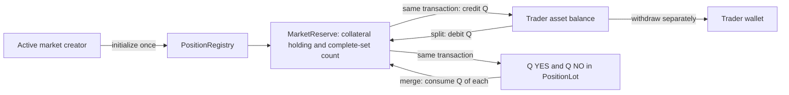

# YES/NO complete sets

A split reserves one collateral unit and creates one YES plus one NO unit. A
merge consumes one of each and returns one collateral unit to the trader's
available balance. There are no orders, outcome transfers or final payouts yet.



## Example

Start with 5 collateral deposited and available:

| Operation | Available | Reserved | YES | NO |
| --- | ---: | ---: | ---: | ---: |
| Before split | 5 | 0 | 0 | 0 |
| Split 3 | 2 | 3 | 3 | 3 |
| Merge 1 | 3 | 2 | 2 | 2 |
| Merge remaining 2 | 5 | 0 | 0 | 0 |

The total collateral stays 5. YES and NO are conditional claims on the same
backing, not two independently redeemable collateral units. Merging makes funds
available inside Outcomia; withdrawal moves them to the trader's wallet.

## Contract boundaries

`PositionRegistry` initializes one reserve per stable market ID within its
configured lineage. It is signed by the operator and dedicated vault. Creation
requires the market creator to remain an active admin, a matching current
protocol, an active collateral admission, and an unexpired Draft or Open market.
The reserve pins all immutable market terms and the exact admitted factory.

This root is separate from `VaultAuthority`, so reserve creation does not contend
with account enrollment. Deployment must pin both roots. Joint operator/vault
signers could create another root; uniqueness is not global. The registry holds
at most 1,024 market IDs. A full index prevents new reserves, not exits.

`MarketReserve` is signed by the operator and vault. Its single holding backs
the outstanding complete-set count. `PositionLot` is signed by the vault and
owner and stores market identity plus whole YES/NO quantities. Lots are Daml
contracts, not Token Standard tokens appearing automatically in a wallet.

Available balances remain per trader/asset. The same balance can fund two
markets using the same collateral and factory. Each market keeps separate
backing and positions. An account enrolled against a different factory is
rejected even if the asset name matches; factory migration needs its own design.

## Split

Only the owner authorizes the split. The supplied current market must match the
reserve's operator, namespace, numeric ID, creator, creation time and all terms.
It must be Open, with ledger time strictly before its cutoff. Quantity must be
positive, fit the available balance and follow the market's whole-contract lot.

The account and reserve holdings are checked and consumed by a vault
self-transfer. The outputs back the new account amount and reserve count. The
same transaction creates the position lot. A full-balance split leaves no
available holding, not a holding with amount zero.

The split uses previously deposited funds and the saved factory. It does not
require a fresh admission. Admission revocation blocks new enrollment/deposits
and reserve creation; stopping splits in an existing market requires closure.

## Merge

The owner supplies 1–16 unique active position lots for the same market and
vault. Each must belong to that owner. The combined YES and NO quantities must
both cover the requested whole-lot quantity, and the reserve count must cover it.
The lots are archived, backing is repartitioned and the reserve count decreases.
Any unburned quantities become one remainder lot.

Merge does not require an open market, active admin or live admission. It works
after closure and cutoff using the saved factory. It cannot overcome an issuer
freeze or unavailable registry. Final resolution/redemption is not implemented:
that future transition must consume the reserve and define subsequent merge
rules. Updating only the lifecycle contract would not disable this merge path.

## Conservation and authority

Before resolution, genuine splits and merges preserve:

```text
outstanding YES = outstanding NO = completeSets
reserve holding amount = completeSets collateral units
available holding amount = available balance
```

`AssetBalance_Repartition` requires both owner and vault authority. Reserve
choices supply the vault authority only after checking account ownership, asset,
factory, namespace and vault. A trader cannot call this internal choice alone.
It checks both old holdings and returns disjoint canonical outputs. The calling
reserve binds its returned holding to the new complete-set count.

Duplicate inputs, stale revisions, inconsistent backing, integer overflow,
short registry outputs or unsupported fragmentation abort the entire
transaction. Archives and registry transfers roll back together. There is no
separate receipt-processing transaction that could issue unbacked positions.

This assumes the approved registry consumes inputs correctly and the vault's
signing authority is controlled as documented in [custody](collateral-custody.md).
Raw vault signing authority is not restricted by these choices. Colluding
signers can directly create alternative contracts; this is not a trustless PDA.

## Contention and visibility

Every split/merge consumes its market reserve. Requests on the same market
serialize; stale requests must reload and retry. Every account revision is also
consumed, so a trader cannot simultaneously spend the same funds in two markets.
One canonical holding per account/reserve bounds transfer inputs to two, but
requires a registry supporting the exact output shape.

Public discovery and contract disclosure remain service work. A wallet does not
gain read access to every reserve or market just by knowing its ID. Local tests
use operator/issuer read access for visibility; a deployed client needs authorized
disclosures or an agreed observer model, not permission to impersonate them.
Private clubs need a separate disclosure design.

## Verification

Run `make DPM="$PWD/target/tools/dpm" test` in this checkout. The position tests
check actual holdings, account amounts and active lot supply. They include two
traders, two markets sharing one account, 16/17 genuine-lot input boundaries,
partial/full merges, cutoff/closure, revocation exits, authorization, wrong
bindings, replay and registry failures after input consumption.

These are local ledger checks. No public Canton deployment, wallet submission,
live registry compatibility or frontend trading is claimed.

Verified in this checkpoint: 48 Daml scripts (17 position scripts), four Python
dependency tests, and production DAR validation with 38 packages.
