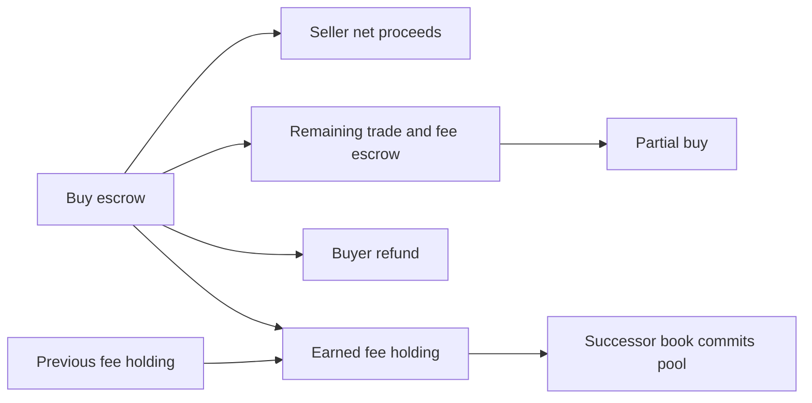

# Trading fees

Fee policy, funded orders, atomic collection and operator withdrawal are locally
implemented. Canton contracts are not deployed. The shared UI must keep trading
disabled until deployment, registry compatibility and wallet submission work.

## Policy and approval

`Protocol` stores `takerFeeBps` and `feeRevision`. Bootstrap both at zero.
Only the operator can call `Protocol_SetTakerFee`; the prototype range is 0–1,000
bps. One basis point is 0.01%, so 25 bps means 0.25%. Ordinary market creators
cannot change the rate. Every update consumes the old protocol and increments
the revision, including updates to the same rate. Exhaustion rejects safely.

New orders supply the live protocol ID, expected revision and expected
`FeeTerms`. Placement checks operator, namespace, rate and pinned asset precision
before moving cash or positions. Stale IDs or mismatched quotes reject the whole
transaction. Each order stores the approved terms; updates affect new orders
only. Partial fills preserve original quantity, acceptance ID and fee snapshot.
Matching and cancellation do not fetch the current policy.

Policy shares the existing protocol contract. An admin update or market creation
also changes that contract ID, so clients must refresh it even if fees did not
change. This avoids another configuration root but couples those operations.
Services must pin the configured lineage; a deliberately duplicated root signed
by the operator is outside that trust boundary.

## Who pays and how rounding works

Only an executed trade earns a trading fee. The older acceptance ID is maker;
the newer ID is taker. Makers pay zero and receive no rebate. The taker's own
snapshotted rate applies to execution price times filled quantity. An order can
be taker in one fill and maker in a later fill.

Placement, cancellation, self-trade prevention, deposits, withdrawals and
complete-set split/merge do not earn trading fees. Network charges are separate.
Resolution and redemption also earn no trading fees.

`Protocol_ApproveAsset` records vetted settlement precision `d`, from 0 to 10.
The smallest transferable unit is `u = 10^-d`. Wallet symbols and display metadata
are not proof of registry precision. Books pin the admitted operator, asset and
factory, and require `priceTick × quantityLot` to be a multiple of `u`.
A 0.001 tick with lot 1 cannot settle in a two-decimal asset; a 0.01 tick can.
A whole-unit asset can use a 0.01 price tick with lot 100.
This book-level check does not add precision gates to existing custody transfers;
those still rely on registry compatibility and exact output validation.

Fees round down to the asset unit:

```text
F(n) = floor((n × rateBps / 10,000) / u) × u
fee for this taker fill = F(previous taker notional + fill gross) - paidFee
```

Signed orders store `originalQuantity`, remaining `quantity`, `takerNotional`
and `paidFee`. Before use, `paidFee` must equal `F(takerNotional)`. Only a taker
fill advances that history. Maker fills neither reset nor increase it. Keeping
cumulative history prevents a split fill from restarting rounding each time.
Separate orders can still underpay by less than one quantum each. No minimum
notional or anti-fragmentation rule is implemented; public nonzero-fee trading
needs an explicit policy for that case.

Arithmetic widens Decimal notional to `Numeric 14` before multiplying by integer
bps and dividing by 10,000. Decimal alone has only ten fractional digits and can
lose the fraction needed for correct rounding. Whole and fractional amounts are
handled separately instead of scaling a large notional into Int64 smallest units.
See [Daml numeric types](https://archived.docs.digitalasset.com/build/3.5/reference/daml/stdlib/Prelude.html).

## Buy funding and refunds

For limit price `L`, remaining quantity `q`, cumulative taker notional `T` and
already paid fee `P`:

```text
trade reserve = L × q
future fee reserve = F(T + L × q) - P
required escrow = trade reserve + future fee reserve
```

Reserve the future cumulative fee delta, not just `F(L × q)`: past fractional
rounding carry can make the next fill owe a fee that a fresh calculation misses.
The original quantity bounds historical spending; rebuilding it from a partial
remainder would lose that bound.

`buyFunding` checks signed history and computes the escrow needed.
`buyFillFunding` computes the fee, price improvement, released fee budget and
new escrow. A maker buy releases unused fee budget even when its execution
price equals its limit. Placement requires the full trade-and-fee reserve.
Cancellation, including self-trade prevention, returns all remaining escrow.
Already collected fees remain earned.

Example: at 25 bps and six decimals, a buy of 5 at 0.60 takes 3 at 0.40:

| Cash movement | Amount |
| --- | ---: |
| Initial escrow | 3.0075 |
| Seller gross proceeds | 1.20 |
| Collected buyer fee | 0.003 |
| Buyer refund | 0.6015 |
| Remaining trade-and-fee escrow | 1.203 |

The order retains original size 5, remaining size 2, taker notional 1.20 and paid
fee 0.003. Cancelling returns 1.203. If it later fills as maker, prior taker
history stays unchanged and unused fee budget is released.

## Sell proceeds

A sell locks outcome contracts, without reserving extra cash. Its taker fee is
deducted from gross proceeds. A sell can execute above its own limit, so its
history bound is filled contracts times the maximum one-unit payout, rather
than filled contracts times its sell limit. A quoted fee at the sell limit is
an estimate, not a maximum.

A cumulative rounding carry can make the entire gross of a tiny fill become
fee. Net proceeds are then zero. Settlement preserves the seller's account ID
and skips its token transfer, because the transfer boundary rejects zero
transfers. Outcome delivery, the fee transfer and all other state changes still
commit together.

## Backing and atomic collection

`OrderBook.fees` embeds `FeePoolState`: earned amount and one optional canonical
vault holding. Empty means amount zero and no holding. Positive fees require a
real, unlocked holding of the pinned collateral asset. The prototype caps each
pool at Int64 maximum units; withdraw before reaching that bound.

Embedding the pool avoids an independently selectable pool contract. It adds no
global asset bottleneck: matching already consumes the market book. Withdrawal
contends with matching on that market, while other markets stay independent.



Settlement recomputes best-price/FIFO from signed orders and then:

1. Validates the buy escrow against its checked funding state.
2. Credits the seller's net proceeds, skipping a zero credit.
3. Consolidates the fee with existing pool backing into one holding.
4. Refunds price improvement and unused fee budget to the buyer.
5. Validates remaining escrow, delivers outcomes and recreates partial orders.
6. Commits the successor book and fill receipt.

Zero fees skip the fee transfer and preserve its holding, while still validating
pool backing. A failure at any later registry call restores every earlier credit,
fee holding, order and book revision. No unbacked numeric credit counts as revenue.

```text
vault cash = available trader cash
           + complete-set reserve backing
           + buy escrow (trade cost + unearned fee reserve)
           + earned protocol fee pools
```

`TradeFill` records the taker's terms and actual fee, refund and remaining buy
escrow. Its `plan` retains the fee-free matching projection: gross price/quantity,
price improvement and remaining trade reserve. Use the receipt's explicit cash
fields for fee-inclusive amounts. Receipts are audit records, not backing.

## Withdrawal and trust

Only the protocol operator can exercise `OrderBook_WithdrawFees`. The destination
is fixed to that operator's wallet. It accepts a positive, precision-aligned
amount no larger than the validated pool and returns actual wallet holdings.
A partial withdrawal keeps canonical pool change; a full withdrawal clears it.
No trader balance or complete-set reserve is an input.

Withdrawal works after market closure or cutoff. It consumes the current book,
so stale withdrawal IDs cannot replay. Failed registry output restores the pool
and its holding. A future arbitrary recipient would require explicit recipient
authorization under the token adapter. Terminal cleanup must preserve a nonempty
pool or empty it through authorized withdrawal.

These are contract-choice guarantees. Raw vault signing authority remains
trusted and can bypass application accounting, as described in
[custody](collateral-custody.md). No public upgrade or migration has occurred.

## Verification

The full suite passes 178 Daml scripts, including 15 collection/withdrawal
scripts, plus four Python checks. Production DAR validation passes with 39
packages. Run `make DPM="$PWD/target/tools/dpm" test` for the ledger suite and independent
arithmetic checks. The production DAR excludes the test registry and daml-script.
Tests cover funded placement, both taker directions, partial-fill accumulation,
changed policy snapshots, cancellation, self-trade prevention, zero-net sellers,
canonical pool backing, operator withdrawal, replay and registry rollback.

The independent Fraction reference checks 4,400 buy lifecycles and 57,510 fill
invariants. Its 308 checked-in fee vectors are verified by
`python3 scripts/generate-fee-vectors.py --check`; the Daml arithmetic grid covers
792 precision/rate/price/quantity/role cases. These do not substitute for the
registry-backed collection and withdrawal tests.

The shared UI builds wallet commands, but deployment, actual registry
compatibility and live wallet-to-ledger verification remain separate work. Local test success must not enable unconfigured public trading.
