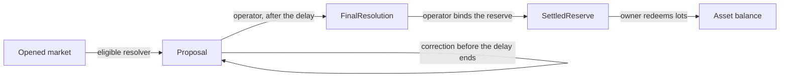

# Resolution and redemption

Resolution fixes the outcome and moves no funds. Redemption then pays holders
from the market's reserve.



## Who resolves

- **Primary resolver:** the market creator, who must be an active admin when acting.
- **Fallback:** only a resolver named in the terms. There is no implicit operator
  fallback.
- **Club and multi-outcome markets:** the factory's current admins resolve, with
  no fallback.

**Windows (ledger time):**

```text
earliest = earliestResolutionAt, or closeAt
primary  = [earliest, fallback.availableAt)
fallback = [fallback.availableAt, fallback.deadlineAt)   (deadline optional)
```

A never-opened market cannot be resolved. A missed deadline leaves the market
unresolved; nothing picks a winner or voids it automatically.

**Role checks use real signatures.** Corrections check roles through the
`ProtocolRoles` interface against the operator's actual signature. A view that only
claims a role is rejected. Always pass the current protocol ID.

## Proposals and corrections

- **Proposing:** consumes the market and records:
  - the outcome: `YesWins`, `NoWins` or `Invalid`;
  - evidence: a 1–4,096-character summary, an `https://` or `ar://` URI of at most
    512 characters, and a lowercase SHA-256;
  - a revision, and `finalizableAt = proposedAt + review delay`.
- **Correcting** (`ResolutionProposal_Correct`) needs the eligible active resolver,
  must come before `finalizableAt`, and must change the outcome or evidence. It
  increments the revision and restarts the full delay. Identical or failed
  corrections leave the timer unchanged.
- **Fallback takeover:** a fallback can replace a primary proposal after handover,
  but only before the current deadline.

The evidence checks confirm the format, not truth or availability: the app must
verify the document.

## Finalization

Only the operator finalizes, at or after `finalizableAt`. It creates
`FinalResolution`, an exact snapshot that nothing can change. Revoking a resolver
later does not undo an earlier valid proposal. The operator is a liveness
dependency.

## Redemption

1. **Bind:** the operator binds the final result to the reserve
   (`MarketReserve_BindResolution`), creating a `SettledReserve`. Split and merge end.
2. **Redeem:** owners redeem 1–16 of their lots at a time
   (`SettledReserve_Redeem`). The payout goes to their asset balance; withdrawal
   then moves it to their wallet.

| Result | One YES | One NO |
| --- | --- | --- |
| YES wins | 1 | 0 |
| NO wins | 0 | 1 |
| Invalid | 0.5 | 0.5 |

**Example:** 3 YES and 2 NO pay 3, 2 or 2.5.

**Rules:**
- **Reserve invariant:** `remainingCollateral = payout(outstanding YES, outstanding
  NO)`. Fees are separate and cannot fund claims.
- **Exact half payouts:** reserves reject lots whose half payout can't be represented
  in the asset's precision, so a whole-unit token needs an even lot.
- **Open orders:** they are not cancelled automatically. Owners cancel them and
  then redeem the returned lots.
- **Lots are fully cleared:** losing lots are consumed with zero payout, and a fully
  redeemed reserve stays as a zero-valued `SettledReserve`.
