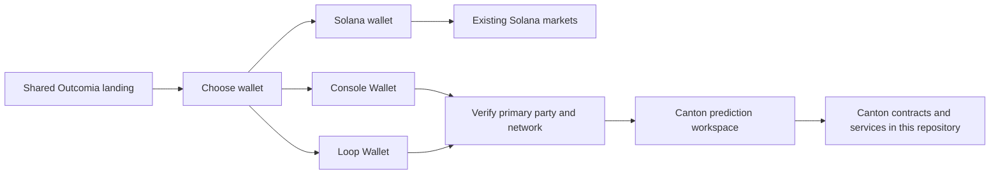

# Shared wallet gateway

The gateway is implemented in the original
[`Outcomia app`](https://github.com/kunal171/outcomia/tree/master/app).
This repository owns Canton contracts and services, not another Next.js app.

The shared app uses `@console-wallet/dapp-sdk` 3.0.0's `consoleWallet` export and
browser-extension approval. Loop uses `@fivenorth/loop-sdk` 0.16.0 and its native
CIP-0103 bridge for hosted-wallet/QR approval. Console mobile QR is not enabled. Signing stays in
the wallet; no signing keys or access tokens enter application session state.

The configured CAIP-2 network, active network and account network must agree.
Console requires an allocated primary party. Loop verifies initialized or allocated
primary metadata and live provider network health. A remembered wallet selection
only requests live verification; it cannot authenticate a party. Account changes
hide the old session while verifying the replacement. Generation checks discard
stale reads. Switching wallets clears the previous workspace before connection.

Solana readers mount only in the Solana workspace; leaving it aborts its HTTP
transport. Either Canton wallet opens `/canton/markets` in the shared UI. It currently
shows `Market deployment pending` rather than fake markets or trading controls.

These checks select the UI; they do not authorize backend requests. Canton
contracts and authenticated services must independently enforce permissions,
collateral ownership and settlement rights.

See [the shared frontend design](https://github.com/kunal171/outcomia/blob/master/docs/shared-frontend.md)
for configuration and verification details. The earlier duplicate frontend is
preserved in this repository's Git history and removed from the current tree.

On 12 November 2026, the user confirmed a real Loop devnet connection and access
to the Canton pages. The deployed app's public browser check also reached Loop's
healthy devnet status endpoint. This confirms connection, not funded balance
reads, registry transfers or contract submission. A test-funding request is
pending. There is no public Loop devnet faucet.
