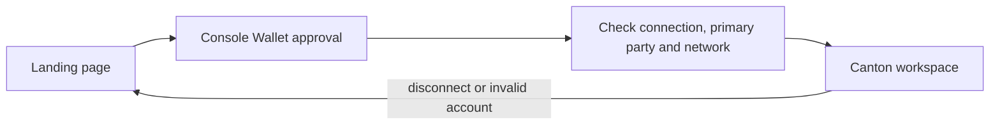

# Console Wallet gateway

## Scope

The first checkpoint is a real Console Wallet connection and a gated Canton
workspace. It contains no Solana/spot code and no simulated market or settlement.
The shared Outcomia brand mark, headline and color tokens are reused.

## Flow

The browser imports the wallet SDK only when needed. The integration uses
`@console-wallet/dapp-sdk` 3.0.0's actual exported `consoleWallet` object; older
README examples use a different export name. Signing remains with the wallet.
The current connection flow targets the browser extension. Mobile QR support
is not enabled by this checkpoint.

The configured network is a CAIP-2 ID such as `canton:devnet`. Console Wallet's
account response uses an enum such as `CANTON_NETWORK_DEV`; the adapter maps it
and checks it against the active network and any network reported in status.
It never infers chain identity from a party string or a UI label.

## Session boundary

- Only a connected wallet with an allocated primary party can enter `/markets`.
- A saved restore hint triggers live verification. It does not contain a party,
  access token or signature and cannot grant entry by itself.
- Every account/status change clears the displayed session while revalidating.
  A generation counter discards stale asynchronous reads.
- Disconnect clears application state and the restore hint before revocation.
  If revocation fails, the UI says the local session is closed and asks the user
  to review site access in Console Wallet.
- Listener subscriptions are removed when disabled or unmounted.
- Wallet state does not authenticate future backend requests. Daml permissions
  and, where needed, a server-verifiable login must enforce those boundaries.

## Presentation state

The landing page and connected workspace use the existing Outcomia visual style,
with light/dark themes and reduced-motion support. The workspace reports
`Market deployment pending` until the next contract checkpoint is implemented.
There is no signing, transaction submission or market-data request in this PR.

## References

- [Console Wallet SDK](https://www.npmjs.com/package/@console-wallet/dapp-sdk)
- [Canton wallet architecture](https://github.com/canton-network/wallet)
- [Canton 3.x ledger model](https://docs.canton.network/overview/learn/ledger-model)
